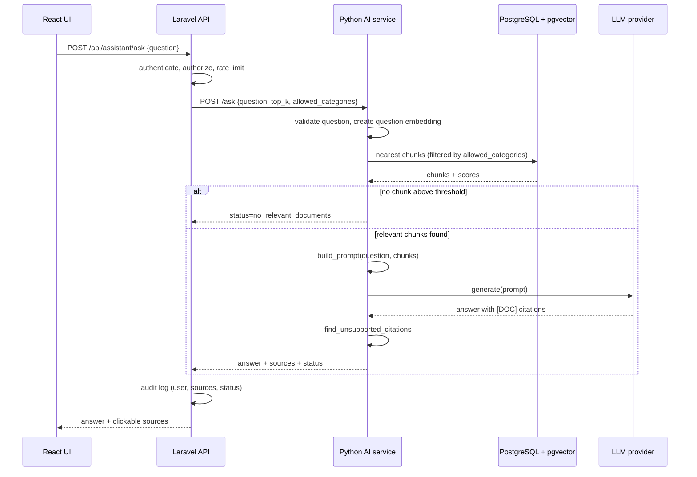

# Phase 2 Architecture (Planned, Not Implemented)

Phase 1 is a single Python process. Phase 2 turns it into a service that a Laravel
API and a React frontend can use, with semantic search and a real LLM. This document
describes the target design and how the Phase 1 code is reused.

```text
React Frontend
    |
Laravel API
    |
Python AI Service
    |
Document Processing
    |
Embedding Generation
    |
Vector Database (PostgreSQL + pgvector)
    |
LLM Provider
    |
Grounded Answer + Source References
```



## Component responsibilities

| Component | Responsibility | Does NOT do |
|-----------|----------------|-------------|
| React frontend | Chat UI, show sources and "not enough information" states | Call the AI service or LLM directly |
| Laravel API | Authentication, roles, rate limiting, audit logging, document permissions | Embeddings, prompts, LLM calls |
| Python AI service (FastAPI) | Ingestion, chunking, embeddings, retrieval, prompts, LLM calls | User management |
| PostgreSQL + pgvector | Store documents, chunks, embeddings; vector similarity search | Business rules |
| LLM provider | Generate text from the prompt | Decide which documents a user may see |

Keeping the LLM and embeddings in Python matches the ecosystem; keeping auth and
permissions in Laravel reuses the existing backend and keeps one source of truth for
users.

## Reuse of Phase 1 code

| Phase 1 piece | Phase 2 change |
|---------------|----------------|
| `AnswerService` | Unchanged. Gets a real `LLMProvider` and a new retriever. |
| `Retriever` protocol | New `PgVectorRetriever` / `HybridRetriever` with the same `retrieve()` signature. |
| `TfidfRetriever` | Kept as the lexical half of hybrid search (or replaced by BM25). |
| `prompt_builder` | Unchanged, possibly split into system + user messages. |
| `knowledge_base.LOADERS` | Add `.pdf` and `.docx` loaders. |
| `AnswerResult.to_dict()` | Becomes the FastAPI response body. |

## API contract (draft)

`POST /ask` (internal, called only by Laravel)

```json
{
  "question": "How can we improve donor retention?",
  "top_k": 3,
  "allowed_categories": ["fundraising", "analytics"]
}
```

Response:

```json
{
  "question": "How can we improve donor retention?",
  "status": "answered",
  "message": "Answer generated from the retrieved context.",
  "answer": "Thank every donor quickly and personally [DOC001]...",
  "sources": [{"id": "DOC001", "title": "Donor Retention"}],
  "retrieved_documents": [{"id": "DOC001", "chunk_id": "DOC001-C02", "score": 0.81}],
  "unsupported_citations": []
}
```

## Database sketch (pgvector)

```sql
CREATE EXTENSION IF NOT EXISTS vector;

CREATE TABLE documents (
    id           TEXT PRIMARY KEY,          -- e.g. DOC001
    title        TEXT NOT NULL,
    category     TEXT NOT NULL,
    source_type  TEXT NOT NULL,
    access_level TEXT NOT NULL DEFAULT 'internal',
    created_at   DATE NOT NULL
);

CREATE TABLE chunks (
    id          TEXT PRIMARY KEY,           -- e.g. DOC001-C02
    document_id TEXT NOT NULL REFERENCES documents(id) ON DELETE CASCADE,
    chunk_index INT  NOT NULL,
    content     TEXT NOT NULL,
    embedding   vector(384) NOT NULL        -- dimension depends on the embedding model
);

CREATE INDEX ON chunks USING hnsw (embedding vector_cosine_ops);

-- Top 3 chunks for a question embedding ($1), cosine similarity = 1 - distance
SELECT c.id, c.document_id, d.title, c.content,
       1 - (c.embedding <=> $1) AS score
FROM chunks c JOIN documents d ON d.id = c.document_id
WHERE d.category = ANY($2)
ORDER BY c.embedding <=> $1
LIMIT 3;
```

## LLM provider sketch

```python
class OpenAIProvider:
    """Implements app.answer_service.LLMProvider."""

    def __init__(self, client, model: str, max_output_tokens: int = 500) -> None:
        self.client = client  # API key read from the environment, never hard-coded
        self.model = model
        self.max_output_tokens = max_output_tokens

    def generate(self, prompt: str) -> str:
        response = self.client.responses.create(
            model=self.model,
            input=prompt,
            temperature=0,  # factual task: reduce randomness
            max_output_tokens=self.max_output_tokens,
        )
        return response.output_text


service = AnswerService(retriever, llm_provider=OpenAIProvider(client, model="..."))
```

Any provider (OpenAI, Anthropic, Azure, a local model) works if it implements
`generate(prompt) -> str`.

## Implementation order

1. Retrieval evaluation set (questions + expected document IDs) and a script that
   reports hit rate@k and MRR. Run it on the TF-IDF baseline first.
2. FastAPI wrapper around the current `AnswerService` (no new AI yet).
3. LLM provider + timeouts, retries, token limits, cost logging.
4. Embedding retriever (in memory first), compare with the evaluation set.
5. Hybrid retrieval; keep it only if the evaluation numbers improve.
6. pgvector storage and an ingestion command.
7. PDF/DOCX loaders.
8. Laravel endpoint (auth, roles, audit) and React UI.

## Non-functional requirements

- **Security:** the AI service is reachable only from Laravel (private network or
  service token); secrets come from a secret manager or environment variables.
- **Privacy:** document-level access control applied *during retrieval*; no real donor
  data sent to an external LLM without an approved data processing agreement;
  questions and answers redacted before logging.
- **Reliability:** timeouts and retries for the LLM; return retrieved sources even if
  generation fails.
- **Observability:** log retrieval scores, chosen sources, latency, token usage and
  status (not raw personal data).
- **Quality:** evaluation set in CI; human review of a sample of answers.
